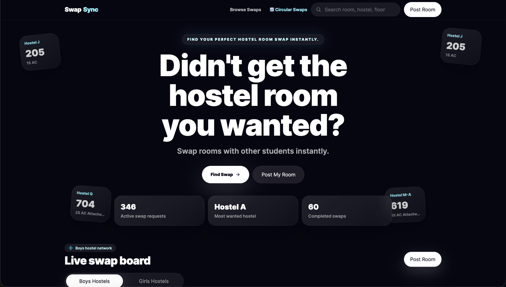
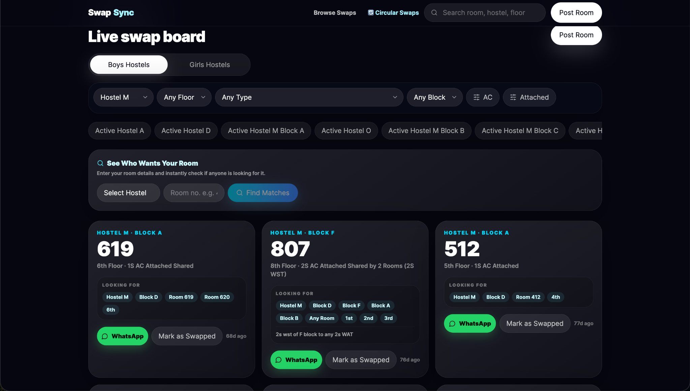
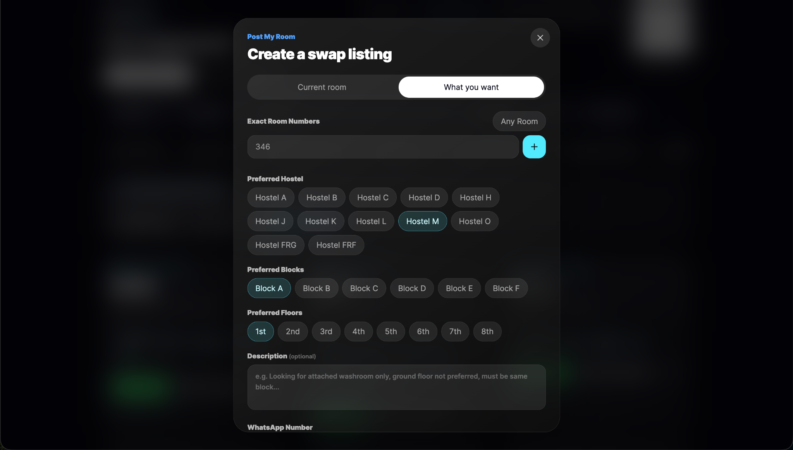
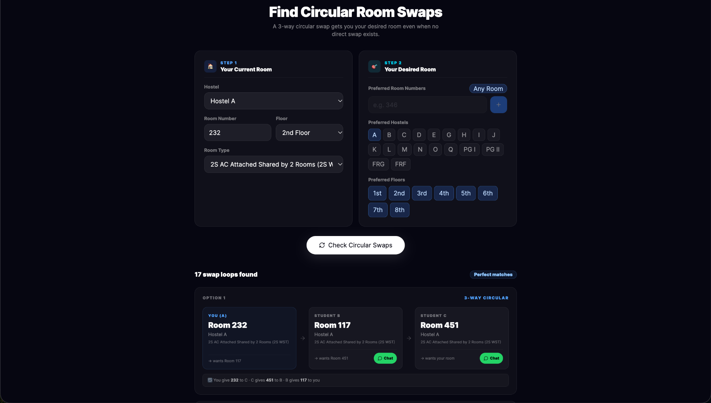
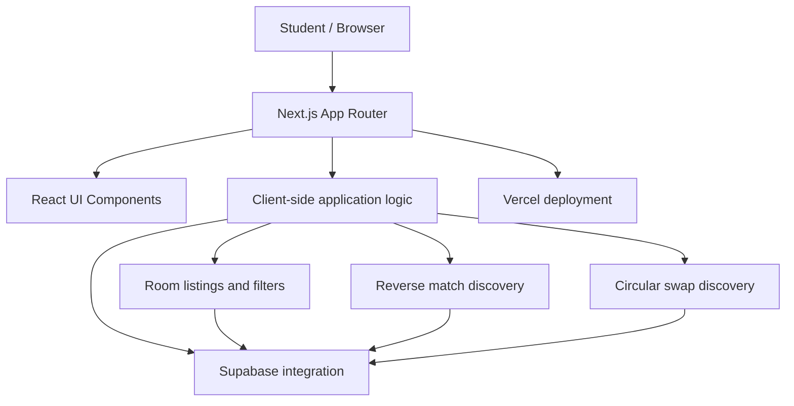
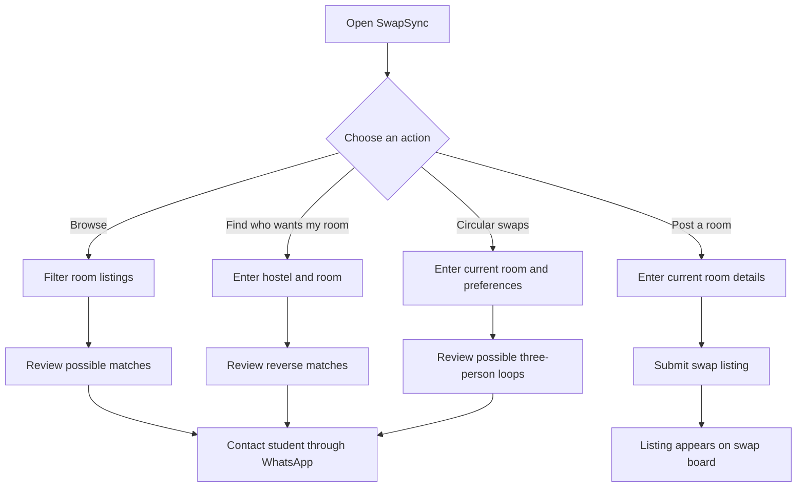
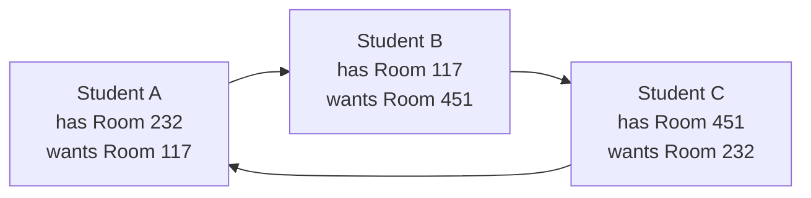

# SwapSync

<p align="center">
  <h3 align="center">Hostel room swaps, without the WhatsApp chaos.</h3>
  <p align="center">
    A student-focused platform for discovering compatible hostel room swaps, including reverse matches and circular swaps.
    <br />
    <a href="https://swap-sync-theta.vercel.app/"><strong>Explore the live app »</strong></a>
  </p>
</p>

<p align="center">
  
  
  
  
  
</p>

---

## Overview

**SwapSync** helps students find room-swap matches during hostel allotment season. Instead of manually tracking requests in scattered chats, students can list their current room, search for preferred rooms, find people who want their room, and explore multi-person swap possibilities.

The project is built with Next.js and TypeScript, with Supabase integration and a responsive interface.

**Live application:** [swap-sync-theta.vercel.app](https://swap-sync-theta.vercel.app/)

## Product walkthrough

### 1. Homepage

The landing page introduces the platform and directs students to browse listings, post a room, or explore circular swaps.



### 2. Live swap board

Browse listings, filter by hostel, floor, room type and block, and check who may be interested in your current room.



### 3. Create a swap listing

Students can enter their current room and select desired room numbers, hostels, blocks and floors, with an optional description.



### 4. Circular swap discovery

A direct one-to-one match is not always possible. The circular swap finder surfaces three-person loops in which each student gets a room they want.



## System architecture

The diagram below is a **high-level, inferred view** based on the repository's Next.js structure and Supabase dependency. Confirm the exact data flow and where matching runs before treating it as a definitive implementation diagram.



[Editable Mermaid source](docs/diagrams/architecture.mmd)

### Main components

| Component | Responsibility |
| --- | --- |
| Next.js / React UI | Renders the landing page, swap board, listing form and circular-swap interface |
| Listing and filtering flows | Helps students browse rooms using hostel and room preferences |
| Reverse matching | Helps identify listings that may want a student's current room |
| Circular matching | Finds potential multi-student swap loops |
| Supabase integration | Backend/database integration used by the application |
| Vercel | Hosts the deployed web application |

## User flow



[Editable Mermaid source](docs/diagrams/user-flow.mmd)

## How circular swaps work

A circular swap can help when no direct exchange exists. In a three-person loop, each student receives the room they prefer by passing their current room to another student.



[Editable Mermaid source](docs/diagrams/circular-swap.mmd)

This is an illustrative example of the matching concept, not a claim about a particular live listing or the exact algorithm implementation.

## Features

- **Room listings:** Post a room-swap request with room and hostel details.
- **Search and filtering:** Explore listings by hostel, room, floor or block.
- **Reverse matching:** Find students who may be interested in the room you currently have.
- **Circular swap discovery:** Identify potential three-way swap opportunities.
- **Hostel separation:** Separate boys' and girls' hostel networks, as supported by the application.
- **Direct coordination:** Continue the conversation through WhatsApp.
- **Responsive interface:** Use the platform on desktop and mobile.

> Matching suggestions help students discover possible swaps. Students should verify details and mutually confirm any arrangement before acting on a match.

## Tech stack

| Technology | Purpose |
| --- | --- |
| [Next.js](https://nextjs.org/) | React framework and application routing |
| [React](https://react.dev/) | UI components |
| [TypeScript](https://www.typescriptlang.org/) | Type-safe application code |
| [Tailwind CSS](https://tailwindcss.com/) | Styling |
| [Framer Motion](https://motion.dev/) | UI animations |
| [Supabase](https://supabase.com/) | Backend/database integration |
| [Vercel](https://vercel.com/) | Deployment |

## Getting started

### Prerequisites

- Node.js compatible with the project's Next.js version
- npm
- Supabase project credentials if you want to connect to your own backend

### 1. Clone the repository

```bash
git clone https://github.com/anjani24/SwapSync.git
cd SwapSync
```

### 2. Install dependencies

```bash
npm install
```

### 3. Configure environment variables

Create a local `.env.local` file using the variable names from [`.env.example`](.env.example). Fill in the values for your own Supabase project.

Never commit `.env.local` or real API keys to Git.

### 4. Start the development server

```bash
npm run dev
```

Open [http://localhost:3000](http://localhost:3000) in your browser.

### Available scripts

```bash
npm run dev    # Start the local development server
npm run build  # Build the production application
npm run start  # Start the production server
npm run lint   # Run ESLint
```

## Project structure

```text
SwapSync/
├── docs/
│   ├── diagrams/
│   │   ├── architecture.mmd
│   │   ├── user-flow.mmd
│   │   └── circular-swap.mmd
│   └── images/
│       ├── homepage.png
│       ├── live-swap-board.png
│       ├── create-swap-listing.png
│       └── circular-swap-finder.png
├── src/
│   ├── app/       # Application routes and UI
│   └── lib/       # Shared libraries and helpers
├── data/          # Project data
├── .env.example
├── package.json
└── README.md
```

## Engineering considerations

- **Matching logic:** Direct matches are not the only useful outcome; circular swaps can help identify multi-student arrangements.
- **Data integrity:** Validate listing inputs and handle unavailable or stale listings gracefully.
- **Privacy:** Only store the information needed for room matching and coordination. Do not publish personal contact information without consent.
- **Reliability:** Verify environment variables, database access policies and production build behavior before deployment.

## Roadmap

- [ ] Confirm and document the implemented matching algorithm.
- [ ] Add automated tests for matching and filtering logic.
- [ ] Add CI to run linting and tests on pull requests.
- [ ] Document the data model and Supabase access policies.
- [ ] Improve empty, loading and error states.

## Contributors

- **Anjani Agarwal** — [LinkedIn](https://www.linkedin.com/in/anjani-ag24)
- **Tatvam Jain** — [LinkedIn](https://www.linkedin.com/in/tatvam-jain-41987b217/)

## Contributing

Suggestions and bug reports are welcome. Open an issue describing the problem or proposed improvement before submitting a change.

## License

No license is currently specified in this repository. Unless a license is added, users should not assume the code is available for unrestricted reuse.

---

<p align="center">
  Built to make hostel room swapping easier for students.
</p>
